# User guide

*[Lire ce guide en français](guide-utilisateur.md)*

This guide is for people who use Pensa — not for those who install it. If you
are setting an instance up, read [the deployment guide](deployment.md) instead.

Pensa holds the organizing of family gifts so that nobody has to keep it in
their head: who wants what, which date is coming up, who is giving what, and
what has already been given. One rule shapes everything else, and it is worth
knowing before anything else: **you never see what is meant for you.**

## Getting in

You do not sign up to Pensa the way you sign up to a website. An instance
belongs to a family and is entered **by invitation**, never by searching for
someone.

Three ways in, depending on what you were given:

- **An invitation code for a household.** Enter it on the sign-up form and you
  join the people you live with, who already share a list of people to give to.
- **An invitation code for a family.** Enter it on the sign-up form and you get
  a household of your own, already attached to that family.
- **A claim code.** Someone has been keeping a list for you — a parent, most
  often. Choose *I have a claim code* on the sign-in screen and the list
  already written under your name becomes yours, with your own email and
  password.

If you are the very first person on a brand-new instance, the sign-up form is
open without any code. After you, it closes.

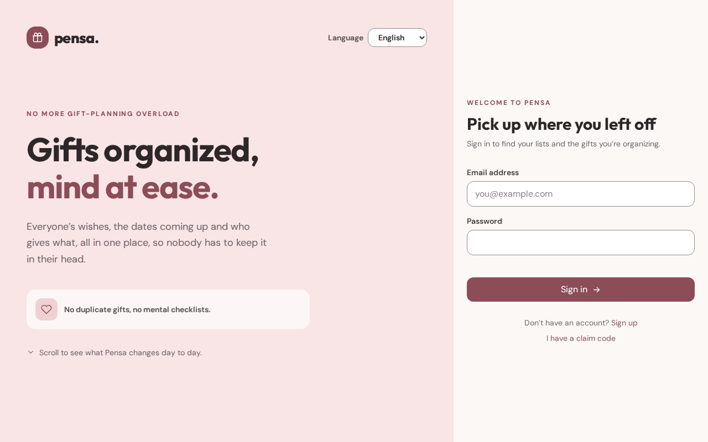

::: tip Household or family?
A **household** is the people who live together. A **family** connects several
households — yours, your parents', your in-laws'. You can belong to more than
one family, and they never see each other: each family view shows only that
family's members.
:::

Your household has **administrators**. They are the ones who accept family
invitations, add members who cannot sign in, and rename things. The first
person in a household is one automatically.

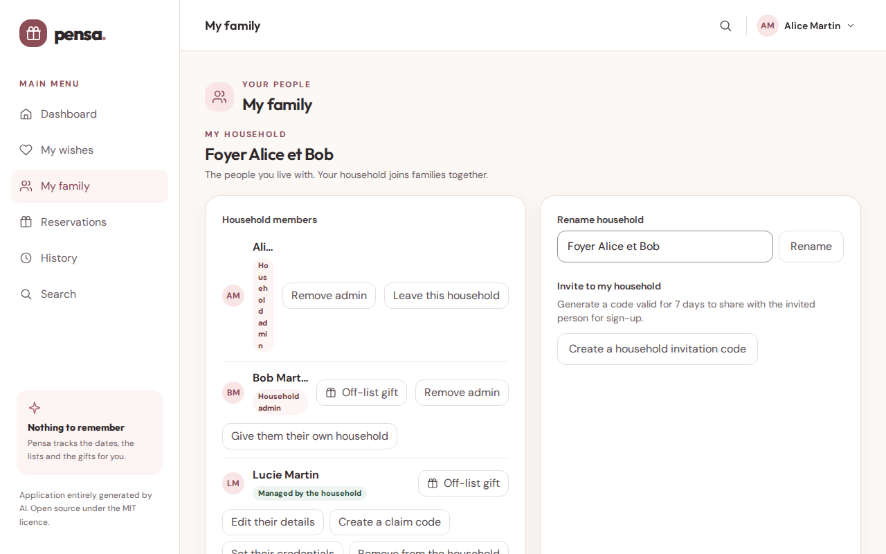

## Your profile

Two fields in your profile are doing work in the background:

- **Date of birth** creates your birthday occasion, and lets the app show ages.
- **Name day** (`MM-DD`, optional) creates your name-day occasion. Without it,
  the occasion simply never comes round.

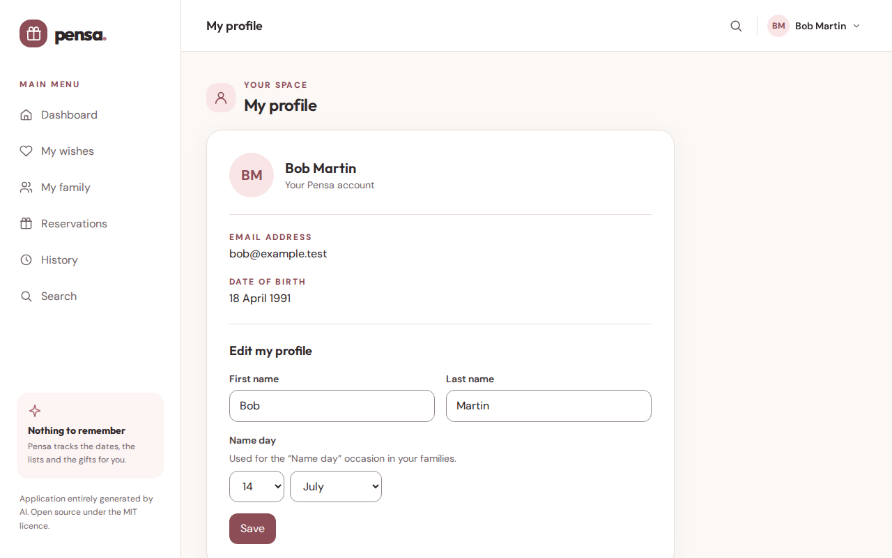

Everything else — your name, your email, your password — is what you would
expect.

## Writing your wish list

Your list is a list of **wishes**. A wish is a title, and optionally a link, a
price, tags and a description.

The fastest way to add one is to **paste a link**. The app fetches the page and
fills in the name, the image and the price for you; correct whatever it got
wrong before saving. If the site refuses to be read — some do — type the title
yourself and the wish works just the same.

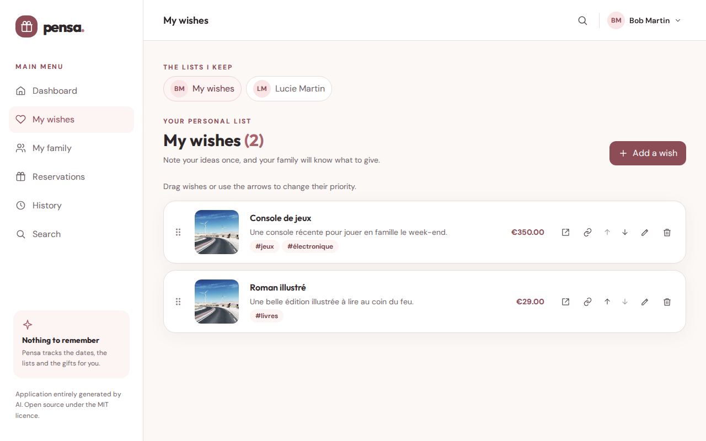

Drag a wish or use its arrows to change its priority, on your own list or a
list your household manages. The arrows with a bar move a wish straight to the
top or bottom of the list. Moves appear immediately; Pensa saves the final
order automatically after a short pause, without reloading the other lists.
Wait for **Order saved** before closing the page. You can visit another screen
in Pensa while it saves. If saving fails, the new order stays visible with an
**Order not saved** warning: use **Try again** once the connection or request
limit allows it. Further moves do not trigger repeated retries.

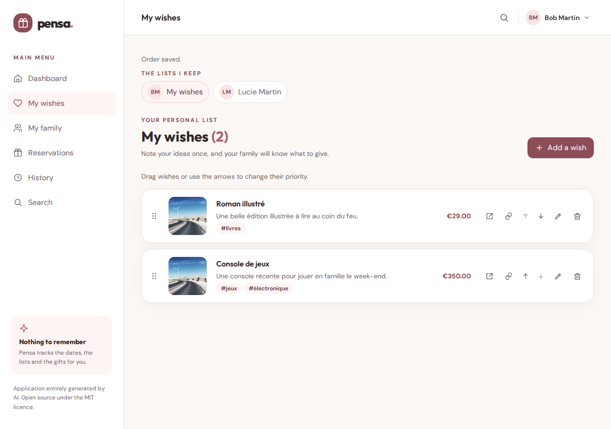

If Pensa cannot check your session because of a temporary error or too many
requests, it shows **Could not check your session**, not the sign-in form.
Use **Try again** after the problem clears; you only need to sign in again
when the session really has expired.

**Tags** are free text: *books*, *cycling*, *small things*. They are what lets
someone reading your list narrow it down to the part they were looking for.

::: tip Already on the list?
If the list already has a wish with the same link or the same name — ignoring
capitals, accents, spacing and tracking bits in the link — Pensa shows the two
side by side before saving. **Cancel** keeps the list as it is, **View the
existing wish** opens the one already there, and **Add anyway** saves the new one
when it really is a different wish, such as another size. Only that person's
visible list is compared: the same idea on someone else's list is never flagged.
:::

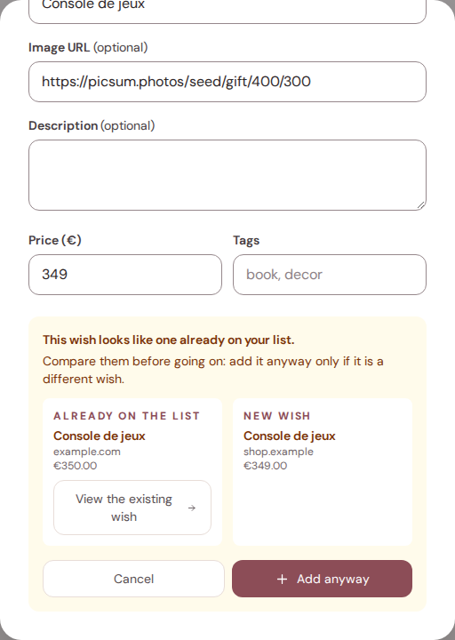

::: warning What stays editable
Once a wish is saved, its **name never changes** — not even after it is
reserved — so nobody checking a reservation finds a different item underneath.
Everything else — the link, the image, the price, the description and the
tags — can still be updated or cleared at any time, by you or by whoever
curates the list on behalf of a managed member. Updating these details never
touches an existing reservation. Deleting a wish does not destroy it either: it
disappears from your list while any reservation attached to it keeps working.
:::

Write freely and in advance. A wish noted in March is the whole point — it is
the one nobody would have remembered in December.

Each wish also has its own link — the small permalink icon next to it opens a
focused page for that one wish, with nothing else on it. It is handy to share
with someone who only needs to see that single idea; it never offers more than
the wish already allowed.

## Occasions

Occasions are the dates gifts hang from. You never create the common ones —
they exist already:

| Kind | Where it comes from |
| --- | --- |
| Birthday | the date of birth in each profile |
| Name day | the optional name-day field in each profile |
| Fixed date | a month and a day set for the family, such as Christmas |

They are listed **in chronological order from today**, not alphabetically, so
what is coming up is at the top and nothing you can no longer act on is in your
way. Each occurrence carries its year, so *Christmas 2026* and *Christmas 2027*
are two different targets.

If you belong to two families, an occasion that exists in both is shown once.

On the dashboard, every upcoming occasion is clickable: it opens the wish list
of the person it concerns.

## Giving: reading a list and reserving

Open someone's list and you see their wishes. You can narrow it down by tag, by
price range, and by what is still available — that last filter is one they will
never see on their own list.

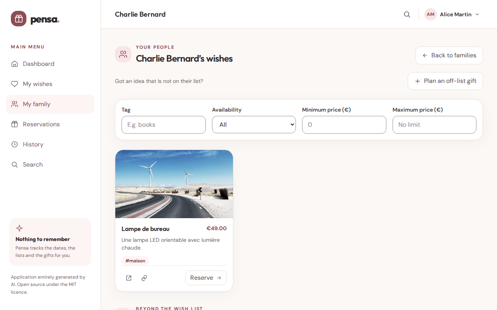

**Reserving** a wish tells the rest of the family it is taken, and tells the
person concerned nothing at all. They will not see who reserved it, or that
anything was reserved.

A reservation is attached to one or more **occurrences** — the next birthday,
the Christmas after that, or both at once when one gift covers two occasions.
The form offers the next occurrence and the one after it.

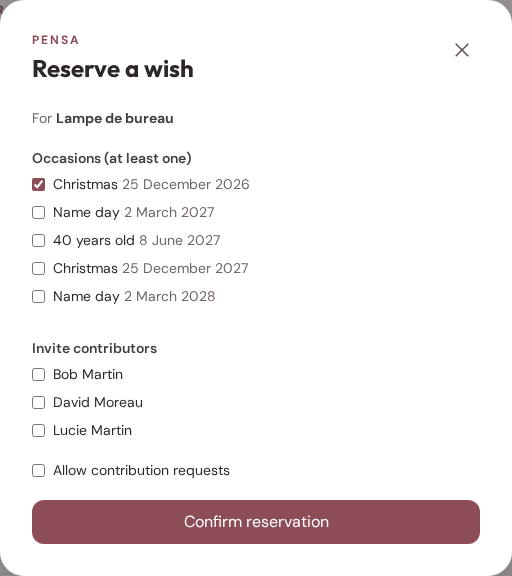

::: tip Nobody can reserve the same gift twice by accident
Two people clicking at the same second cannot both get it. The second one is
told it has just been taken, before anything is bought.
:::

## Following through

A reservation is not a status, it is a small job to finish. It moves through
four steps:

**Reserved → Bought → Wrapped → Given**

Tick each one as you go. What is left to do surfaces on your dashboard, with
its date, so the app is a to-do list rather than a shelf of labels. When the
last step is ticked the gift moves into the history.

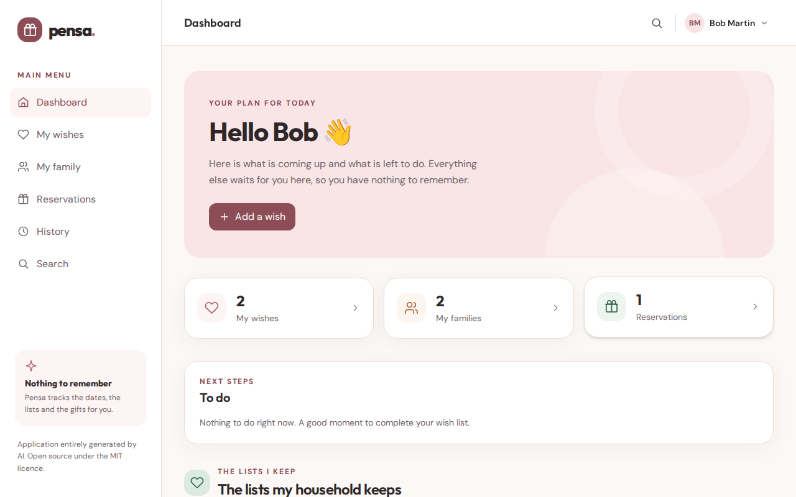

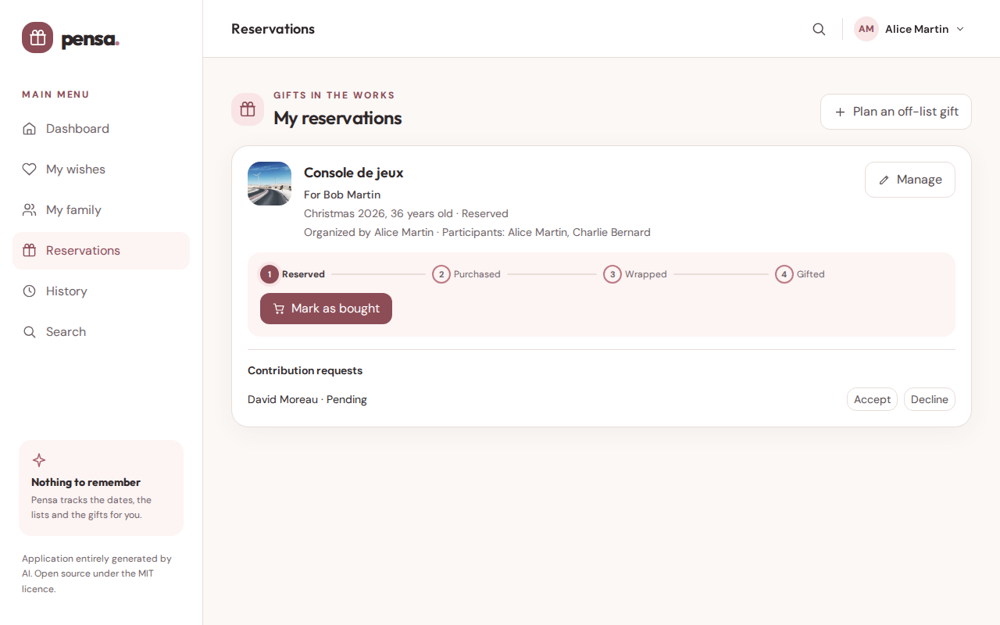

## Gifts nobody asked for

Not every gift comes from a list. An **off-list gift** is a reservation created
straight for a person and an occasion, with no wish behind it — the idea you had
on your own.

Create one from the top of a person's wish list, beside a member's list action,
beside an upcoming occasion, or from **Reservations**. The recipient and occasion
are prefilled when you start from that context, but you can always change them.
Changing the recipient loads their occasions before you can save. The gift is
private by default; choose **Visible and open to contributions** to invite others
to ask to join.

It can be:

- **private**, visible only to you and invited participants while active; or
- **visible** to the rest of the family, so that others can ask to join in.

Either way the person receiving it sees nothing.
These choices apply during preparation. Once given, even a private gift is
shared in the recipient's current family history, still excluding the recipient.

If a wish is deleted while reserved, the same commitment becomes a **private
off-list gift**. Details, participants, occasions and progress remain; open
contributions are turned off. Its organizer can edit it and continue preparing it.

## Several people on one gift

On a reservation that is open to contributions, others can **ask to
participate**. Whoever organizes the gift accepts or declines. Accepted
participants then see the gift, and appear in its history alongside the
organizer.

This is the conversation that usually happens behind someone's back in a group
chat — except here the person cannot stumble into it.

## Keeping a list for someone who cannot sign in

Children, and anyone else who should not have an account, exist in Pensa as
**managed members**: real people, with a date of birth, occasions and a wish
list, but no way to log in.

Any administrator of their household creates them and writes their list. From
the outside, nothing looks different — the rest of the family sees an ordinary
list and reserves on it without ever learning who wrote it. Your dashboard will
remind you when a managed list is still empty, so a birthday does not arrive
with nothing on it.

When you add them, *Ma famille → Mon foyer → Ajouter un membre sans compte* asks
for a first name, a last name, a date of birth and, optionally, a **name day**.
Without a name day, the *Fête* occasion is simply never announced for them. If
you left it out, or got a date wrong, *Modifier la fiche* next to their name
reopens the whole record — name, date of birth and name day — and saves it in
place.

**Getting to their list quickly.** You do not have to walk through the family
screen: the lists your household keeps appear on your dashboard, and a row of
shortcuts sits at the top of *Mes envies*. One click switches between your own
list and theirs, and back.

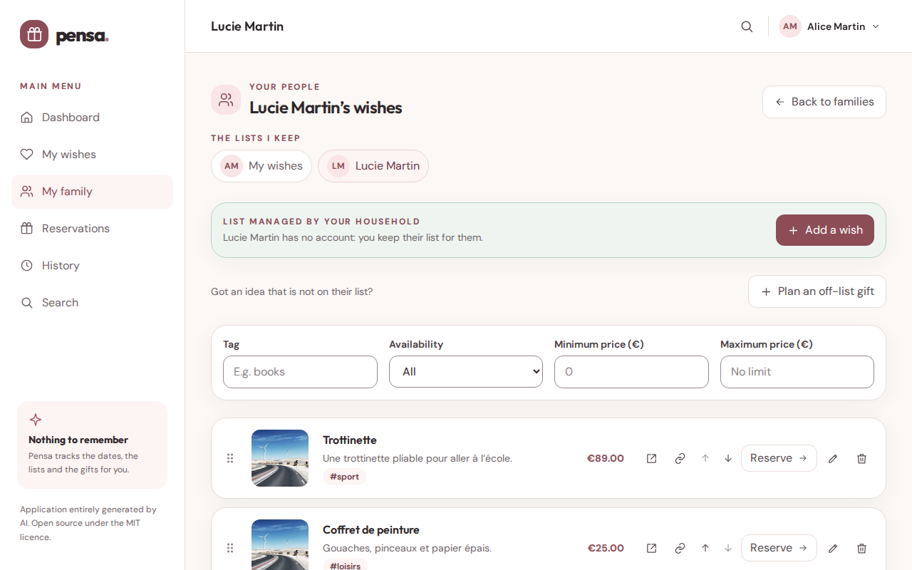

Nobody stays managed forever. Two ways out:

- **A claim code.** Generate one, hand it over, and the person opens their own
  account from the sign-in screen, choosing their email and password and keeping
  every wish already written.
- **Credentials set by an administrator**, for someone who is not there to do it
  themselves.

Once they have their own account they can **leave the household** and get one of
their own, automatically attached to the same families — so moving out does not
drop them out of the gift circle. Either they or an administrator can start it.
A household never loses its last member or its last administrator, and a managed
member is never an administrator.

Family administrators can appoint or remove other family administrators from
family management. Only members with accounts are eligible, the last admin
cannot be removed, and household permissions do not change.

## What has already been given

Once a gift is marked as given it is kept in the **history**, readable by the
people who currently share a family with its recipient, **except the recipient**,
including gifts that were private while being prepared. It answers the question
behind most duplicate gifts: *what did we already give them?*

Each entry identifies the gift and its recipient, with the organizer,
participants, occasion and gift date when available. If the gift date was not
recorded, the record date is labeled instead. Unavailable recipient details
are labeled as such; missing optional information is not guessed.

Choose a **Recipient** to review their accessible gifts across all recorded
occasions and years. Sort **Newest first** (the default), **Oldest first** or
**Recipient (A-Z)**, with newest gifts first within each person. The recipient
selector contains only people from accessible history; an unavailable selection
shows no gifts and can be cleared by choosing **All recipients**. Filters and
sorting remain in the URL when you use browser back/forward.
Leaving the shared families removes access, even if you organized or contributed
to those gifts. The recipient never sees their own gifts in history.

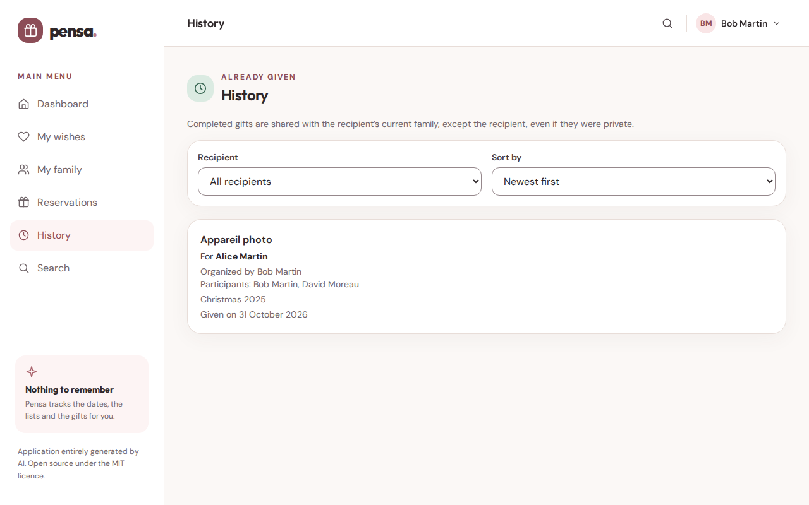

**Search** covers people, wishes and past gifts in your shared families. Each
wish result names the person whose list it belongs to. Off-list, deleted and
already given wishes do not appear as wishes, and your own results never reveal
reservations. Gifts already given appear as **Already given** results — found by
their name, their recipient, organizer, participants or occasion — under exactly
the same rule as the history: never to their recipient. **View** opens the
history on that recipient with the gift highlighted.
While searching, previous results clear and loading or errors are shown.

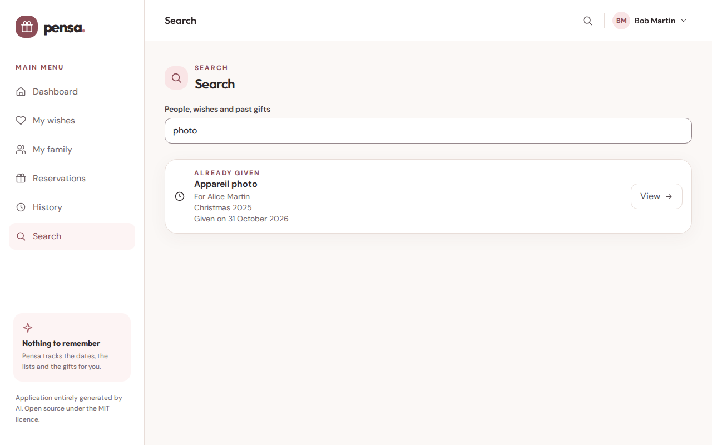

## French and English

The whole interface switches language in one click, and remembers your choice
in your browser. Dates, prices and error messages follow. What people typed —
wish titles, descriptions, tags — is never translated, because it is theirs.

## The rule: you never see what is meant for you

This is not a setting you can turn on. It is how the app is built.

- You cannot see who reserved something on your list, or that anything was
  reserved at all.
- You cannot see an off-list gift meant for you, private or visible.
- You cannot see who is contributing to a gift for you, or how many.

The app does not merely hide these things behind a message saying you are not
allowed — it answers as though they did not exist, because *being told you are
not allowed* would itself be a clue. That is why Pensa can be shared with the
whole family without anyone having to be careful about what they click.

History helps you review gifts given to others in your current families, never
gifts meant for you.

## Questions people ask

**Can I use Pensa with only part of my family?**
Yes — that is what households and families are for. A household joins several
families, and each family sees only its own members.

**I reserved something and changed my mind.**
Cancel the reservation; it goes back to available for everyone else, and the
person concerned never knew either way.

**Someone in the family has no account and never will.**
Add them as a managed member. Their list uses the same display and reordering
controls as *my wishes*, and the rest of the family sees it like anyone else's.

**Is my data safe?**
Pensa is a personal project, not a commercial service — it is
[entirely generated by AI](../README.md#this-project-was-entirely-generated-by-ai)
and comes with no guarantee. Whoever runs your instance is responsible for it.
Put in what you would be able to lose.

---

Curious about the mechanics behind all this? [What Pensa does](features.md)
describes the same ground from the product's side, and
[the API reference](api.md) from the code's.
